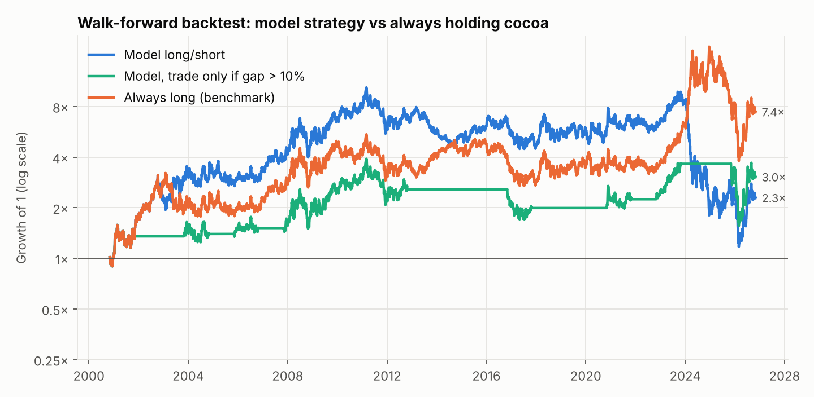
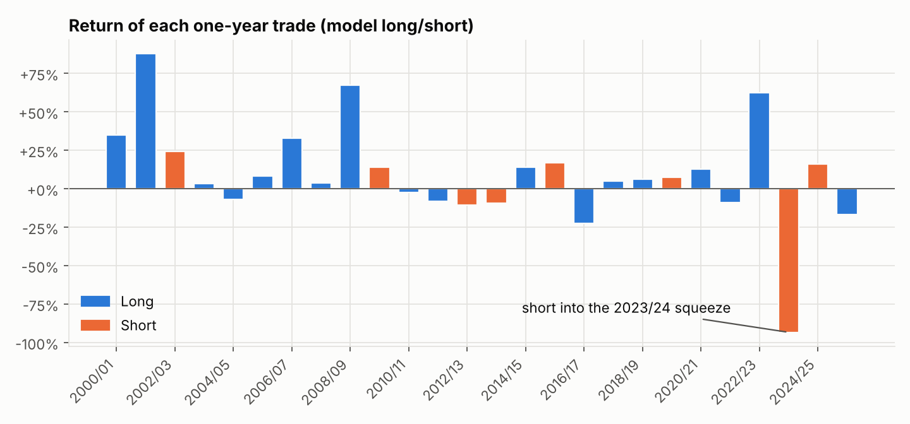

# Backtest: long/short cocoa futures on the model's signal

## Result

**The strategy made money but did not beat simply holding cocoa, and its edge is not statistically
distinguishable from zero.** Over 26 one-year trades (2000/01 to 2025/26) it averaged
+9% a year with a Sharpe ratio of 0.27 (t-stat 1.4); always being long averaged
+12% with a Sharpe of 0.36. Its worst trade, a short into the 2023/24 price
squeeze, lost 93%.

| Strategy | Average return / year | Volatility | Sharpe | t-stat | Hit rate | Compound return / year | Max drawdown | Worst year |
|---|---|---|---|---|---|---|---|---|
| Model long/short | +9% | 34% | 0.27 | 1.4 | 65% | +3% | -89% | -93% |
| Model, trade only if gap > 10% | +6% | 20% | 0.30 | 1.5 | 67% | +4% | -60% | -22% |
| Price equation only (no weather) | +9% | 34% | 0.27 | 1.4 | 65% | +3% | -89% | -93% |
| Model, crop data one year late | +3% | 35% | 0.09 | 0.4 | 62% | -2% | -88% | -93% |
| Always long (benchmark) | +12% | 33% | 0.36 | 1.9 | 58% | +8% | -79% | -24% |

## What the numbers say

- **Direction was right 65% of the time**, against 58% for always-long. The 18 long trades
  averaged +15%; the 8 shorts averaged -4% (+8% excluding 2023/24).
- **One trade dominates.** Without 2023/24 the strategy averages +13% a year with a Sharpe of
  0.50. But a valuation model that shorts a market 5% above fair value has no defence
  against a supply squeeze, so that loss is a feature of the approach, not bad luck.
- **The size of the gap carries little information.** The correlation between the model's gap and
  the following year's price move is +0.17. Trading only when the gap exceeds 10% (12 of 26 years)
  cuts volatility and drawdown but not enough to change the conclusion (Sharpe 0.30).
- **Weather added nothing in real time.** The positions are identical with the weather nowcast switched off:
  with only 15–40 years of history at each decision date, the country output models rarely
  passed their own skill test, so the walk-forward nowcast sat close to trend. The signal is, in
  effect, mean reversion plus last season's crop shortfall.
- **Data timing matters.** If the previous season's crop size is only known a year late (closer to
  how FAOSTAT is actually published), the Sharpe ratio falls to 0.09.

## Current signal

On the 02 Nov 2026 entry date the future was $5,435 against a walk-forward fair value of
$5,368: a gap of -1.2%, nominally short. Against the current futures strip ($5,074) the gap is
+5.6%, nominally long. Both are inside the 10% no-trade band, so the practical position is **flat**.

## Trade log

| Crop year | Entry | Futures | Fair value | Gap | Position | Market move | Trade return |
|---|---|---|---|---|---|---|---|
| 2000/01 | 01 Nov 2000 | $753 | $925 | +21% | long | +35% | +35% |
| 2001/02 | 01 Nov 2001 | $1,026 | $1,117 | +9% | long | +88% | +88% |
| 2002/03 | 01 Nov 2002 | $1,901 | $1,801 | -5% | short | -24% | +24% |
| 2003/04 | 03 Nov 2003 | $1,422 | $1,904 | +29% | long | +3% | +3% |
| 2004/05 | 01 Nov 2004 | $1,453 | $1,489 | +2% | long | -7% | -7% |
| 2005/06 | 01 Nov 2005 | $1,368 | $1,678 | +20% | long | +8% | +8% |
| 2006/07 | 01 Nov 2006 | $1,463 | $1,608 | +9% | long | +33% | +33% |
| 2007/08 | 01 Nov 2007 | $1,974 | $2,246 | +13% | long | +4% | +4% |
| 2008/09 | 03 Nov 2008 | $1,969 | $2,625 | +29% | long | +67% | +67% |
| 2009/10 | 02 Nov 2009 | $3,250 | $2,884 | -12% | short | -14% | +14% |
| 2010/11 | 01 Nov 2010 | $2,759 | $3,508 | +24% | long | -2% | -2% |
| 2011/12 | 01 Nov 2011 | $2,600 | $3,107 | +18% | long | -8% | -8% |
| 2012/13 | 01 Nov 2012 | $2,420 | $2,369 | -2% | short | +11% | -11% |
| 2013/14 | 01 Nov 2013 | $2,651 | $2,473 | -7% | short | +9% | -9% |
| 2014/15 | 03 Nov 2014 | $2,861 | $2,986 | +4% | long | +14% | +14% |
| 2015/16 | 02 Nov 2015 | $3,295 | $3,025 | -9% | short | -17% | +17% |
| 2016/17 | 01 Nov 2016 | $2,696 | $3,274 | +19% | long | -22% | -22% |
| 2017/18 | 01 Nov 2017 | $2,123 | $2,126 | +0% | long | +5% | +5% |
| 2018/19 | 01 Nov 2018 | $2,264 | $2,334 | +3% | long | +6% | +6% |
| 2019/20 | 01 Nov 2019 | $2,478 | $2,397 | -3% | short | -7% | +7% |
| 2020/21 | 02 Nov 2020 | $2,257 | $2,652 | +16% | long | +13% | +13% |
| 2021/22 | 01 Nov 2021 | $2,564 | $2,686 | +5% | long | -9% | -9% |
| 2022/23 | 01 Nov 2022 | $2,348 | $2,756 | +16% | long | +63% | +63% |
| 2023/24 | 01 Nov 2023 | $3,794 | $3,609 | -5% | short | +93% | -93% |
| 2024/25 | 01 Nov 2024 | $7,341 | $6,942 | -6% | short | -16% | +16% |
| 2025/26 | 03 Nov 2025 | $6,559 | $8,239 | +23% | long | -17% | -17% |

## How the test was run

- Each 1 November the whole model is rebuilt from data up to that date: trend and cycle of
  production through the season just ended, output models re-selected, price equation re-estimated
  on prices to September. Weather windows still in the future are blanked.
- Long if fair value is above the futures price, short if below; held twelve months; one unit of
  notional, no leverage. Daily returns are from the front-month continuous contract.
- The fair value here ($5,368) differs slightly from the main report's because this version
  standardises inputs only on data available at the time.

## Caveats

- **26 trades is a very small sample.** A Sharpe ratio of 0.27 over 26 years has a standard error
  of about 0.20; nothing here is statistically significant.
- **Roll yield and costs are excluded.** The continuous front-month series is not roll-adjusted, so
  the cost or gain of rolling contracts (large in 2024's backwardation), commissions and
  collateral interest are not in these returns.
- **Some hindsight remains.** The model's design (variables, windows, per-country structure) was
  chosen with the full history in view, and FAOSTAT figures are today's revised values, assumed
  known one month after the season ends. Real-time results would likely be somewhat worse.
- Not investment advice.
