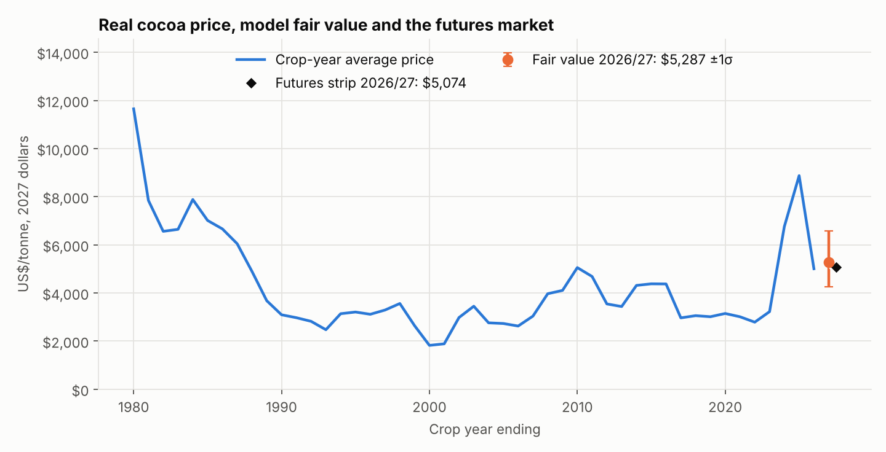
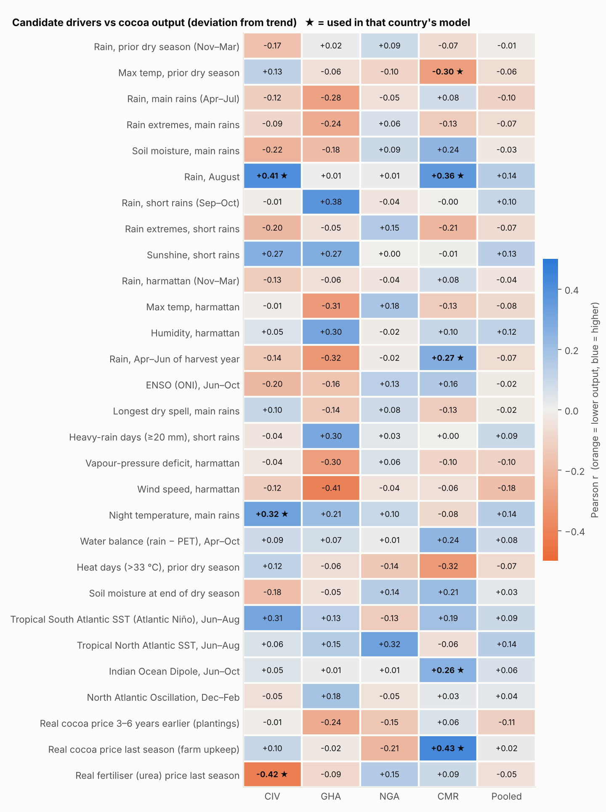
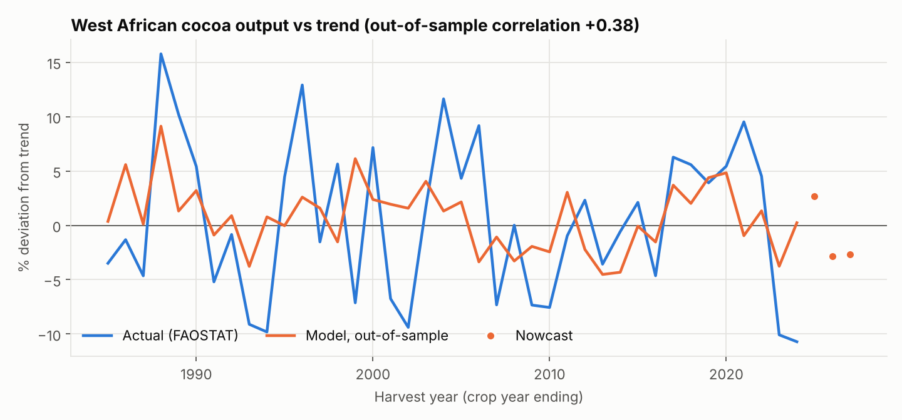

# West African cocoa: weather, harvest and futures valuation

*Run date 12 Nov 2026 · futures as of 11 Nov 2026 18:29 UTC · target crop year 2026/27 (Oct 2026 – Sep 2027)*

## Verdict

**ICE New York cocoa futures for 2026/27 average $5,074/t; the model's fair value is
$5,287/t (68% band $4,245 – $6,583). The market is roughly fairly valued
(-4.0% vs fair value, z = -0.19).** One standard deviation of the forecast is
about ±22%, so the gap is not statistically meaningful.

| Model | Fair value | 68% band | Futures vs fair | z-score | Verdict |
|---|---|---|---|---|---|
| Per-country, original weather variables | $5,489 | $4,402 – $6,845 | -7.6% | -0.36 | roughly fairly valued |
| **+ 20 added data points (headline)** | $5,287 | $4,245 – $6,583 | -4.0% | -0.19 | roughly fairly valued |
| + 5 unconventional variables (test) | $5,287 | $4,241 – $6,591 | -4.0% | -0.19 | roughly fairly valued |

## What the added data changed

| Model | CIV | GHA | NGA | CMR | W. Africa correlation | Price forecast error |
|---|---|---|---|---|---|---|
| First version (one pooled model) | – | – | – | – | -0.13 | 0.196 |
| Per-country, original weather variables | +0.15 | -0.13 (not used) | -0.05 (not used) | +0.21 | +0.28 | 0.196 |
| **+ 20 added data points** | +0.22 | -0.26 (not used) | -0.33 (not used) | +0.15 | +0.38 | 0.196 |
| + 5 unconventional (test) | +0.15 | -0.26 (not used) | -0.38 (not used) | +0.07 | +0.32 | 0.195 |

Country columns are the honest out-of-sample R² of each country's output model ("nested"
leave-one-year-out: the variable search is repeated inside every held-out year, so the score is
not flattered by the search). A country model is used only if that R² exceeds
0.05; otherwise the country is held at trend. "W. Africa correlation" is
predicted vs actual aggregate output, out of sample. "Price forecast error" is the RMSE of
one-year-ahead log price forecasts since 1990 (no-change forecast: 0.216).

Two things improved the model:

1. **Fitting each country separately** instead of pooling. Weather responses differ by country, and
   pooling averaged them to nothing.
2. **4 of the 20 added data points** earned a place in a country model that works out of
   sample (table below): night temperature, indian ocean dipole, real cocoa price last season, real fertiliser.
   Côte d'Ivoire's out-of-sample R² goes from +0.15 to +0.22; Cameroon's goes from
   +0.21 to +0.15. Côte d'Ivoire is about 60% of the region's crop, so the West African
   correlation rises from +0.28 to +0.38.

Ghana and Nigeria still have no usable weather model, and none of the added market variables
improved the price equation.

### Scorecard: 15 added data points tested on output

Numbers are each variable's correlation with that country's output deviation from trend.

| Data point | CIV | GHA | NGA | CMR | Result |
|---|---|---|---|---|---|
| Longest dry spell, main rains | +0.10 | -0.14 | +0.08 | -0.13 | rejected |
| Heavy-rain days (≥20 mm), short rains | -0.04 | +0.30 | +0.03 | +0.00 | rejected |
| Vapour-pressure deficit, harmattan | -0.04 | -0.30 | +0.06 | -0.10 | rejected |
| Wind speed, harmattan | -0.12 | -0.41 | -0.04 | -0.06 | rejected |
| Night temperature, main rains | +0.32 | +0.21 | +0.10 | -0.08 | **used (CIV)** |
| Water balance (rain − PET), Apr–Oct | +0.09 | +0.07 | +0.01 | +0.24 | rejected |
| Heat days (>33 °C), prior dry season | +0.12 | -0.06 | -0.14 | -0.32 | rejected |
| Soil moisture at end of dry season | -0.18 | -0.05 | +0.14 | +0.21 | rejected |
| Tropical South Atlantic SST (Atlantic Niño), Jun–Aug | +0.31 | +0.13 | -0.13 | +0.19 | picked (NGA) but model failed out of sample |
| Tropical North Atlantic SST, Jun–Aug | +0.06 | +0.15 | +0.32 | -0.06 | picked (NGA) but model failed out of sample |
| Indian Ocean Dipole, Jun–Oct | +0.05 | +0.01 | +0.01 | +0.26 | **used (CMR)** |
| North Atlantic Oscillation, Dec–Feb | -0.05 | +0.18 | -0.05 | +0.03 | rejected |
| Real cocoa price 3–6 years earlier (plantings) | -0.01 | -0.24 | -0.15 | +0.06 | rejected |
| Real cocoa price last season (farm upkeep) | +0.10 | -0.02 | -0.21 | +0.43 | **used (CMR)** |
| Real fertiliser (urea) price last season | -0.42 | -0.09 | +0.15 | +0.09 | **used (CIV)** |

### Scorecard: 5 added market data points, plus climate indices, tested on price

Each is added to the price equation on its own. "Forecast error change" is the change in
out-of-sample RMSE; negative is better.

| Data point | t-stat | Forecast error change | Result |
|---|---|---|---|
| Rest-of-world cocoa output vs trend | +0.4 | +11.5% | rejected |
| World GDP growth, prior year | +1.8 | +2.3% | rejected |
| Sugar price change, prior season | +0.2 | +1.4% | rejected |
| Palm oil price change, prior season | -1.4 | -1.5% | rejected |
| Cocoa price volatility, prior season | +0.7 | +2.6% | rejected |
| Tropical South Atlantic SST (Atlantic Niño), Jun–Aug | -0.1 | +2.5% | rejected |
| Tropical North Atlantic SST, Jun–Aug | -0.5 | +16.5% | rejected |
| Indian Ocean Dipole, Jun–Oct | +1.8 | -2.6% | rejected |
| North Atlantic Oscillation, Dec–Feb | -0.0 | +1.6% | rejected |
| ENSO (ONI), Jun–Oct | +1.3 | -0.5% | rejected |

## The test: 5 unconventional variables

Sunspots, the stratospheric quasi-biennial oscillation, the gold price, the rubber-to-cocoa price
ratio and the date of Easter were put through exactly the same procedure.

| Data point | CIV | GHA | NGA | CMR | Result |
|---|---|---|---|---|---|
| Sunspot number, prior year | -0.28 | -0.18 | +0.18 | -0.44 | rejected |
| Quasi-biennial oscillation (stratospheric wind) | -0.09 | +0.08 | +0.17 | -0.02 | rejected |
| Real gold price (illegal-mining pressure) | -0.05 | +0.02 | +0.02 | +0.17 | rejected |
| Rubber-to-cocoa price ratio (crop switching) | -0.06 | +0.05 | -0.12 | +0.11 | picked (NGA) but model failed out of sample |

| Data point | t-stat | Forecast error change | Result |
|---|---|---|---|
| Sunspot number, prior year | -1.9 | +0.1% | rejected |
| Quasi-biennial oscillation (stratospheric wind) | -0.1 | +1.6% | rejected |
| Real gold price (illegal-mining pressure) | +0.4 | +0.1% | rejected |
| Rubber-to-cocoa price ratio (crop switching) | +0.0 | +3.0% | rejected |
| Easter date (days after 1 March) | -0.9 | +3.7% | rejected |

**Result: none survives, and letting them compete makes the model worse.**
The search picked Rubber-to-cocoa price ratio (crop switching) (NGA) for an output model that then failed out of sample. With them in the candidate pool, Côte d'Ivoire's honest R² drops by 0.07 because the search
is distracted by chance fits in some folds. In the price equation 1 of the 5 has |t| > 1.5 –
sunspots look as "significant" as world GDP growth or the Indian Ocean Dipole – yet none lowers
forecast error, and a price equation that searches over all of them forecasts far worse
(RMSE 0.291 vs 0.195). That is the useful lesson of the test: in a sample of ~59 years, an in-sample
t-statistic near 2 is what noise looks like, which is why every variable here has to pass an
out-of-sample check before it is used. The headline model excludes all five.

## 1. Output models

Production: FAOSTAT, 1961–2024. Target is each country's output deviation from its
HP trend. Weather: NASA POWER daily data averaged over 16 cocoa-belt points, as
anomalies (σ) in these windows relative to harvest year H:

- **dry0** – Dry season before flowering (Nov H-2 – Mar H-1): tree stress / carry-over
- **rains1** – Main rains (Apr–Jul H-1): flowering and pod set of the main crop
- **aug** – Little dry season (Aug H-1): pod filling
- **rains2** – Short rains (Sep–Oct H-1): pod maturation; excess → black pod
- **dry1** – Harmattan dry season (Nov H-1 – Mar H): main-crop tail, mid-crop set
- **rains3** – Apr–Jun H: mid-crop development
- **enddry0** – Feb–Mar H-1: end of the dry season, moisture at season start
- **season** – Apr–Oct H-1: whole main-crop growing season

| Country | Honest R² | Drivers |
|---|---|---|
| Côte d'Ivoire | +0.22 | Rain, August (+3.8% per σ); Real fertiliser (urea) price last season (-3.5% per σ); Night temperature, main rains (+2.4% per σ) |
| Ghana | -0.26 | none reliable – held at trend |
| Nigeria | -0.33 | none reliable – held at trend |
| Cameroon | +0.15 | Rain, August (+2.8% per σ); Max temp, prior dry season (-3.3% per σ); Real cocoa price last season (farm upkeep) (+3.2% per σ); Indian Ocean Dipole, Jun–Oct (+2.7% per σ); Rain, Apr–Jun of harvest year (+2.1% per σ) |

### Current season

| Inputs for 2026/27 | CIV | GHA | NGA | CMR |
|---|---|---|---|---|
| Max temp, prior dry season | +0.2σ | -1.6σ | +2.3σ | +2.2σ |
| Rain, August | -1.4σ | +0.3σ | -0.4σ | -0.4σ |
| Rain, Apr–Jun of harvest year | not yet observed | not yet observed | not yet observed | not yet observed |
| Night temperature, main rains | +1.7σ | +1.5σ | +1.8σ | +1.6σ |
| Indian Ocean Dipole, Jun–Oct | not yet observed | not yet observed | not yet observed | not yet observed |
| Real cocoa price last season (farm upkeep) | +0.1σ | +0.1σ | +0.1σ | +0.1σ |
| Real fertiliser (urea) price last season | +0.6σ | +0.6σ | +0.6σ | +0.6σ |

| Crop year | CIV | GHA | NGA | CMR | W. Africa |
|---|---|---|---|---|---|
| 2024/25 | +5.6% | +0.0% | +0.0% | -8.4% | +2.7% |
| 2025/26 | -2.9% | +0.0% | +0.0% | -11.0% | -2.8% |
| 2026/27 | -3.1% | +0.0% | +0.0% | -8.1% | -2.7% |

Inputs not yet observed are set to normal. The West African nowcast carries a ±7% standard error.

## 2. Price model

Crop-year average real price (World Bank / ICCO, CPI-deflated), 63 years:
`Δlog P = a + b1·S + b2·S(-1) + g·log P(-1)` where S is West African output vs trend.

| Term | coef | t-stat |
|---|---|---|
| Constant | +0.837 | +2.0 |
| Supply shock, current crop | -0.777 | -2.5 |
| Supply shock, previous crop | -1.151 | -3.6 |
| Lagged log real price | -0.098 | -2.0 |

R² = 0.31. A West African crop 10% below trend raises the real price by about
8% that season and a further 12% the next. Prices revert towards a long-run real
level of about $5,057/t at 10% a year. Out of sample this beats a no-change forecast by
9% in RMSE.

## 3. Futures curve

| contract | expiry | price |
|---|---|---|
| CCZ26 | 2026-12 | $4,923 |
| CCH27 | 2027-03 | $5,061 |
| CCK27 | 2027-05 | $5,110 |
| CCN27 | 2027-07 | $5,140 |
| CCU27 | 2027-09 | $5,138 |
| CCZ27 | 2027-12 | $5,113 |
| CCH28 | 2028-03 | $5,103 |
| CCK28 | 2028-05 | $5,001 |

Strip for 2026/27 = average of contracts expiring Oct 2026 – Sep 2027: **$5,074/t**.
Last completed crop year (2025/26) averaged $4,882/t.

## Caveats

- Skill is modest: the output models explain roughly a fifth of the variation in Côte d'Ivoire and
  Cameroon and none in Ghana or Nigeria. Choosing which countries get a model is itself a
  selection step, so true skill is probably a little lower than shown.
- FAOSTAT is calendar-year, revised late and ends in 2024; output for later seasons is the
  model's nowcast, not reported data. Use `--shock` to feed in your own crop estimate.
- The most recent months of NASA POWER rainfall come from a near-real-time product and can be
  biased against the long history.
- Still missing: stocks, grindings, port arrivals, pod counts and positioning. These are the data
  most likely to improve the model further, and they are not freely available with long history.
- Forecast error is ±22% (1σ) on a one-year view. Not investment advice.
