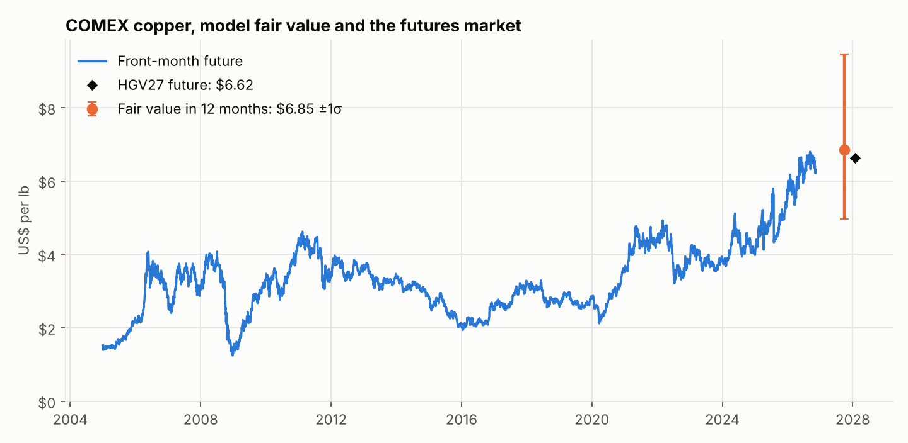
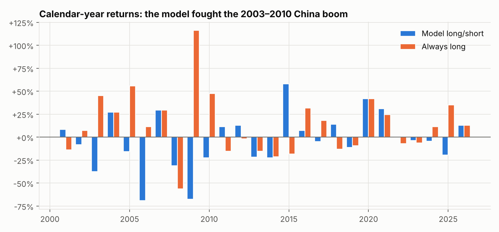
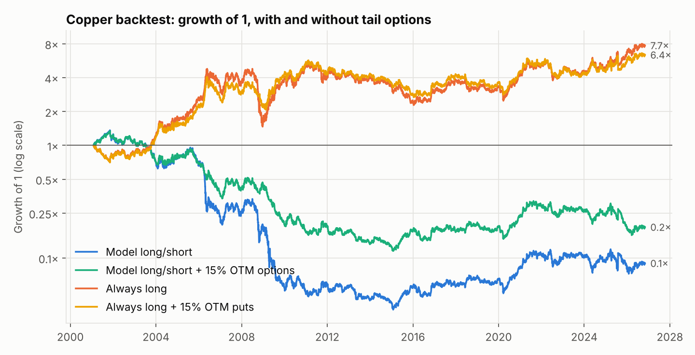

# Copper: drivers, fair value and a futures strategy with tail options

*Run date 12 Nov 2026 · futures as of 12 Nov 2026 05:58 UTC · model data to Oct 2026*

## Verdict

**Copper futures look roughly fairly valued, but this model has no proven ability to forecast
copper, so that verdict carries little weight.** The model's fair value twelve months out is
$6.85/lb ($15,100/t; 68% band $4.97 – $9.44); the HGV27 future is
$6.62/lb, 3.3% below it (z = -0.10). The front month is $6.23/lb.

Three findings matter more than the valuation:

1. **No forecasting skill.** Run forward through history with no hindsight, the model's
   12-month forecasts were worse than assuming no change (out-of-sample R² -0.30).
2. **The long/short strategy lost money**: -4.4% a year (Sharpe -0.15) over 103 quarterly trades, against
   +12.0% (Sharpe 0.42) for simply holding copper.
3. **Tail options did their job on a plain long position.** Buying 15% out-of-the-money puts each
   quarter cut the worst quarter from -49% to -23% and the maximum drawdown from -69% to
   -53%, at a cost of 1.8% a year in return.

## How this differs from the cocoa model

Copper has no harvest, so the weather → crop step is replaced by 22 candidate drivers in
five groups: demand (leading indicators, GDP), financial conditions (dollar, yields, equities),
relative value against other commodities, copper's own price history, and supply (mine output,
ENSO disruption risk). The target is the change in the real copper price over the next 12 months.
Selection, walk-forward testing and option pricing follow the cocoa model.

## 1. Drivers

"Correlation" is with the next 12 months' real price change (1972 onward). "Forecast error alone"
is the change in out-of-sample squared error when the driver is used on its own; negative is
better. "Chosen" is how often the walk-forward search picked it.

| Driver | Group | Correlation | Forecast error alone | Chosen (share of years) | In current model |
|---|---|---|---|---|---|
| G20 leading indicator, level vs trend | demand | -0.39 | -11% | 65% | **yes** |
| G20 leading indicator, 6-month change | demand | -0.04 | +3% | never | no |
| China leading indicator, level vs trend | demand | -0.29 | +5% | never | no |
| China leading indicator, 6-month change | demand | +0.01 | +14% | never | no |
| World GDP growth, latest published year | demand | +0.07 | +4% | never | no |
| China GDP growth, latest published year | demand | +0.09 | +3% | never | no |
| US dollar index, 12-month change | financial | -0.16 | +2% | 23% | no |
| US dollar index vs its 10-year average | financial | -0.02 | +12% | never | no |
| US 10-year yield, 12-month change | financial | -0.04 | +1% | never | no |
| US 10-year yield, level | financial | -0.16 | +9% | never | no |
| S&P 500, 12-month return | financial | -0.23 | -1% | never | no |
| Copper price volatility, 12 months | financial | +0.01 | +14% | 4% | no |
| Copper-to-gold ratio vs its 10-year average | relative value | -0.20 | +7% | never | no |
| Copper-to-aluminium ratio vs its 10-year average | relative value | -0.05 | +7% | never | no |
| Oil price, 12-month change | relative value | -0.19 | +10% | never | no |
| Iron ore price, 6-month change | relative value | -0.06 | +19% | never | no |
| Zinc / nickel / aluminium, 12-month change | relative value | +0.01 | +5% | 65% | **yes** |
| Real copper price vs its 10-year average | own price | -0.13 | +28% | never | no |
| Real copper price vs its 5-year average | own price | -0.09 | +22% | never | no |
| Copper price, 12-month change | own price | -0.03 | +6% | never | no |
| World mine output growth, latest published year | supply | -0.12 | +1% | 4% | no |
| ENSO (Chile / Peru weather disruption) | supply | +0.20 | +1% | never | no |

Only the G20 leading indicator lowers forecast error on its own, and it is a contrarian signal:
when the business cycle is running hot, copper tends to fall over the following year.

### Current model

| Term | Coefficient | Latest value | Effect on forecast |
|---|---|---|---|
| Constant | +0.008 |  |  |
| G20 leading indicator, level vs trend | -0.113 | +0.08 | -1.2% |
| Zinc / nickel / aluminium, 12-month change | +0.262 | +0.10 | +2.2% |

Forecast real price change over the next 12 months: **+2.6%**.

### Honest skill (walk-forward, 2001–today)

| Version | Out-of-sample R² | Correlation | Direction right | Forecast error (1σ) |
|---|---|---|---|---|
| Model long/short | -0.30 | -0.05 | 55% | 32% |
| Market data only (no revised indicators) | -0.36 | -0.46 | 41% | 33% |
| With 3 placebo variables (test) | -0.39 | -0.04 | 50% | 33% |

Every version is worse than a no-change forecast. The search kept choosing the leading indicator
because it had worked before 2000, and the relationship then failed during the China-driven boom.

### Placebo test

Sunspots, the stratospheric wind cycle and the cocoa price were offered to the search as a check.

| Driver | Group | Correlation | Forecast error alone | Chosen (share of years) | In current model |
|---|---|---|---|---|---|
| Sunspot number | test | -0.16 | +1% | 27% | no |
| Quasi-biennial oscillation (stratospheric wind) | test | -0.02 | +3% | 58% | no |
| Cocoa price, 12-month change | test | +0.00 | +3% | never | no |

The walk-forward search picked sunspot number in 27% of years, quasi-biennial oscillation in 58% of years.
The version with placebos even shows a positive backtest (+6.4% a year, Sharpe 0.22),
which is luck: nothing connects stratospheric winds to copper. A search over this many variables on
this little data finds patterns whether or not they exist, and that applies equally to the
conventional drivers above.

## 2. Long/short backtest

Each quarter (first trading day of February, May, August, November) the position follows the sign
of the walk-forward forecast and is held three months in the front-month COMEX future.

| Strategy | Return / year | Volatility | Sharpe | t-stat | Hit rate | Worst quarter | Max drawdown |
|---|---|---|---|---|---|---|---|
| Model long/short | -4.4% | 29% | -0.15 | -0.8 | 49% | -53% | -97% |
| Market data only (no revised indicators) | -6.8% | 29% | -0.23 | -1.2 | 47% | -53% | -97% |
| With 3 placebo variables (test) | +6.4% | 29% | 0.22 | 1.1 | 51% | -48% | -83% |
| Model, trade only if forecast > 5% | -3.7% | 25% | -0.15 | -0.8 | 45% | -53% | -94% |
| Always long (benchmark) | +12.0% | 29% | 0.42 | 2.1 | 56% | -49% | -69% |

- **The model fought the trend.** From 2003 to 2010 it lost in 6 of 8 years while copper rose in 7.
  A model built on mean reversion and the business cycle was short through most of the China boom.
- **Removing the revised indicators does not help** (Sharpe -0.23). OECD leading indicators are
  revised after publication, so the main version is, if anything, flattered.
- **Copper has had a strong upward drift** (+12.0% a year since 2001), so any strategy that is
  often short starts well behind.

## 3. Tail options

Each position buys one three-month option: a put under a long, a call over a short.

| Strategy | Return / year | Volatility | Sharpe | Worst quarter | Max drawdown | Premium / year | Option payoff / year |
|---|---|---|---|---|---|---|---|
| Model long/short, unhedged | -4.4% | 29% | -0.15 | -53% | -97% | – | – |
| + options 10% OTM | -4.1% | 21% | -0.19 | -21% | -89% | 9.2% | 9.5% |
| + options 15% OTM | -3.8% | 23% | -0.16 | -24% | -91% | 5.6% | 6.2% |
| + options 20% OTM | -3.8% | 25% | -0.15 | -28% | -93% | 3.5% | 4.1% |
| Always long, unhedged | +12.0% | 29% | 0.42 | -49% | -69% | – | – |
| Always long + puts 15% OTM | +10.2% | 25% | 0.40 | -23% | -53% | 4.5% | 2.6% |

- **On the model's long/short**, options cap the worst quarter (-53% to -24%) and lower volatility,
  and they roughly pay for themselves (5.6% a year in premium, 6.2% back) because the
  model was so often on the wrong side of big moves. They do not turn a losing signal into a
  winning one.
- **On a plain long position**, 15% OTM puts cost 4.5% a year and returned 2.6%. The Sharpe
  ratio is about the same (0.42 to 0.40) and the drawdown is clearly shallower. This is the one
  structure here I would call useful.

Sensitivity of the model + 15% OTM options to the option-pricing assumption:

| Implied vol ÷ realised vol | Return / year | Sharpe | Premium / year |
|---|---|---|---|
| 1.00× | -2.1% | -0.09 | 3.9% |
| 1.15× | -3.8% | -0.16 | 5.6% |
| 1.30× | -5.7% | -0.24 | 7.6% |
| 1.50× | -8.6% | -0.36 | 10.4% |

## 4. Tracking: current position and what protection costs

- **Signal:** forecast +2.6% over 12 months, so nominally long; below the 5% conviction
  threshold, so the practical position is **flat**.
- **Three-month tail options today**, with the front month at $6.23/lb and 60-day realised
  volatility of 22% (assumed implied 26%), as a share of notional:

| Strike distance | Put | Call |
|---|---|---|
| 10% OTM | 1.42% | 1.80% |
| 15% OTM | 0.59% | 0.98% |
| 20% OTM | 0.20% | 0.50% |

These are model estimates, not quotes. Rerun `python -m copper_model` to refresh the signal, the
fair value and these costs.

## Futures curve

| Contract | Expiry | US$/lb | US$/t |
|---|---|---|---|
| HGZ26 | 2026-12 | 6.224 | 13,722 |
| HGG27 | 2027-02 | 6.343 | 13,984 |
| HGK27 | 2027-05 | 6.391 | 14,090 |
| HGQ27 | 2027-08 | 6.537 | 14,412 |
| HGX27 | 2027-11 | 6.577 | 14,500 |
| HGH28 | 2028-03 | 6.793 | 14,976 |

## Caveats

- **Option prices are modelled**: Black-76, implied volatility = 60-day realised × 1.15, no skew, no
  bid-ask spread. Copper puts usually carry skew, so downside protection is probably under-priced.
- **Futures returns** use the front-month continuous contract with no roll adjustment or costs.
- **Supply data is thin.** World mine output is annual and the detailed USGS series ends in 2020
  (later years are approximate summary figures). Exchange inventories, treatment charges and
  Chinese import data, which practitioners rely on, are not freely available.
- **Prices before 2000 are monthly averages** (World Bank), which smooths them; trading results
  use daily futures from 2001.
- 103 quarterly trades over one commodity cycle. Not investment advice.
