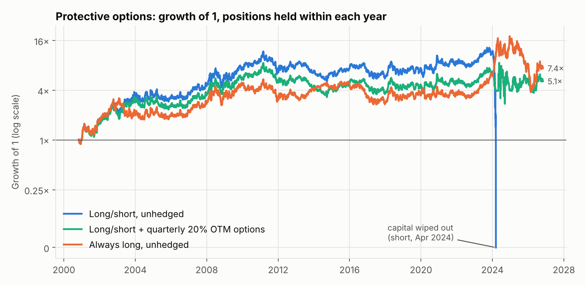
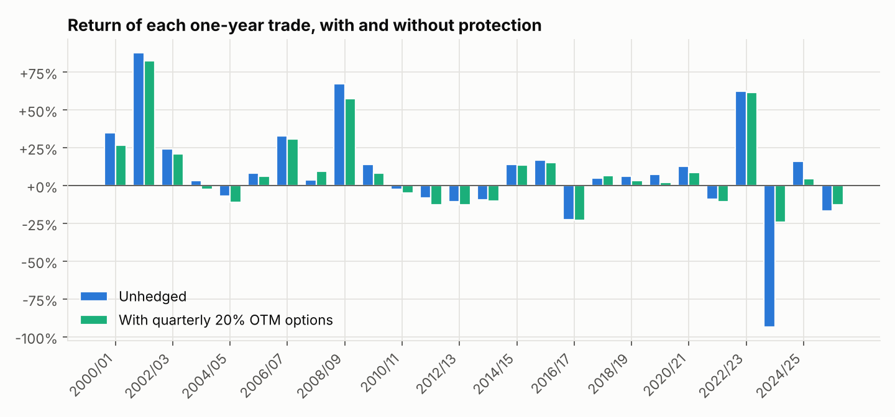

# Backtest: long/short with protective puts and calls

Each long futures position buys an out-of-the-money put; each short buys an out-of-the-money call.
Signals and trade dates are the same as in [the unhedged backtest](backtest_report.md).

## Result

**Protection does what you want on the tail and roughly pays for itself, but it does not create an
edge.** With options 20% out of the money, rolled quarterly, the worst year improves from
-93% to -24% and the average return is about unchanged (+9.2% to +9.1%), so the
Sharpe ratio rises from 0.27 to 0.35. That is still no better than simply holding cocoa
unhedged (0.36).

| Strategy | Avg return / year | Volatility | Sharpe | Compound / year | Worst year | Max drawdown | Premium / year | Option payoff / year |
|---|---|---|---|---|---|---|---|---|
| Model long/short, unhedged | +9.2% | 34% | 0.27 | wiped out | -93% | -100% (wiped out) | – | – |
| + quarterly options, 10% OTM | +5.1% | 24% | 0.21 | +2.8% | -20% | -67% | 16.3% | 12.2% |
| + quarterly options, 20% OTM | +9.1% | 26% | 0.35 | +6.5% | -24% | -68% | 7.6% | 7.4% |
| + 12-month option, 10% OTM | +4.1% | 25% | 0.16 | +1.6% | -23% | -69% | 9.1% | 4.0% |
| + 12-month option, 20% OTM | +6.4% | 27% | 0.24 | +3.6% | -25% | -64% | 5.7% | 2.9% |
| + 12-month option, 30% OTM | +8.2% | 28% | 0.30 | +5.2% | -33% | -62% | 3.5% | 2.4% |
| Always long, unhedged | +11.9% | 33% | 0.36 | +8.0% | -24% | -79% | – | – |
| Always long + 12-month put, 20% OTM | +7.1% | 33% | 0.22 | +3.0% | -37% | -71% | 5.0% | 0.3% |

Returns are per one-year trade on the entry notional, with the position held (not rebalanced)
through the year, so the unhedged drawdown is worse here than in the first backtest. "Premium" and "Option payoff" are averages
per year as a share of notional. Option prices are modelled, not historical – see the assumptions.

## What the numbers say

- **The tail is fixed.** The unhedged short in 2023/24 lost 93% by year end, and at the April
  2024 peak the loss exceeded the capital behind it. With calls 20% above the market, rolled
  quarterly, the year's loss is 24%.
- **Protection costs 7.6% of notional a year and paid back 7.4%.** It is close to break-even
  only because of a few large reversals: it helped in 4 of 26 years, most in
  2023/24 (+69%), 2007/08 (+6%), 2025/26 (+4%), and cost an average of 3.8% in the other 22.
- **Strike distance matters more than tenor.** Options 10% out of the money cost
  16% a year and drag the average return down to +5.1%. At 20–30% the cost is
  3%–8% and most of the tail protection is kept.
- **Quarterly rolling beat a single 12-month option here** (Sharpe 0.35 vs 0.24) because strikes
  reset after big moves and pay again if the move continues. That gap rests on a handful of years
  and I would not rely on it.
- **Protection is most expensive exactly when you want it.** After the 2024 spike, volatility
  above 60% made a one-year 20% call cost about a quarter of notional, turning the profitable
  2024/25 short into a loss with the 12-month structure.
- **Hedging does not rescue a strategy without an edge.** Always-long with a 12-month put does
  worse than always-long without (0.22 vs 0.36): on average you pay more for
  options than they return.

## Sensitivity to the option-pricing assumption

The headline structure (quarterly, 20% OTM) at different ratios of implied to realised volatility:

| Implied vol ÷ realised vol | Avg return / year | Sharpe | Compound / year | Premium / year |
|---|---|---|---|---|
| 1.00× | +11.3% | 0.44 | +8.9% | 5.3% |
| 1.15× | +9.1% | 0.35 | +6.5% | 7.6% |
| 1.30× | +6.5% | 0.25 | +3.8% | 10.1% |
| 1.50× | +2.8% | 0.10 | -0.5% | 13.9% |

If cocoa options really cost 30% more than realised volatility implies, the hedged strategy is no
better than the unhedged one on Sharpe, though the tail protection remains.

## What protection would cost today

With the front-month future at $4,907 and 60-day realised volatility of 42% (assumed implied
48%), as a share of notional:

| Option | 3 months | 12 months |
|---|---|---|
| Put, 10% OTM | 5.0% | 13.6% |
| Put, 20% OTM | 2.1% | 8.9% |
| Call, 10% OTM | 5.9% | 15.4% |
| Call, 20% OTM | 3.4% | 12.5% |

These are model estimates; check live ICE quotes before acting. The model's current signal is
flat, so there is no position to protect at the moment.

## Trade log (quarterly, 20% OTM)

| Crop year | Position | Unhedged | Hedged | Difference |
|---|---|---|---|---|
| 2000/01 | long + put | +35% | +27% | -8% |
| 2001/02 | long + put | +88% | +83% | -5% |
| 2002/03 | short + call | +24% | +21% | -3% |
| 2003/04 | long + put | +3% | -3% | -6% |
| 2004/05 | long + put | -7% | -11% | -4% |
| 2005/06 | long + put | +8% | +6% | -2% |
| 2006/07 | long + put | +33% | +31% | -2% |
| 2007/08 | long + put | +4% | +10% | +6% |
| 2008/09 | long + put | +67% | +58% | -10% |
| 2009/10 | short + call | +14% | +9% | -5% |
| 2010/11 | long + put | -2% | -5% | -3% |
| 2011/12 | long + put | -8% | -13% | -5% |
| 2012/13 | short + call | -11% | -13% | -2% |
| 2013/14 | short + call | -9% | -10% | -1% |
| 2014/15 | long + put | +14% | +14% | -0% |
| 2015/16 | short + call | +17% | +15% | -2% |
| 2016/17 | long + put | -22% | -23% | -1% |
| 2017/18 | long + put | +5% | +7% | +2% |
| 2018/19 | long + put | +6% | +4% | -3% |
| 2019/20 | short + call | +7% | +2% | -5% |
| 2020/21 | long + put | +13% | +9% | -4% |
| 2021/22 | long + put | -9% | -10% | -2% |
| 2022/23 | long + put | +63% | +62% | -1% |
| 2023/24 | short + call | -93% | -24% | +69% |
| 2024/25 | short + call | +16% | +5% | -12% |
| 2025/26 | long + put | -17% | -13% | +4% |

## Assumptions and caveats

- **Option prices are modelled.** Black-76 on the front-month future, implied volatility =
  60-day realised volatility × 1.15, no skew, no bid-ask spread, no interest. Real cocoa calls
  usually carry extra skew, so short-side protection is probably under-priced here.
- **The headline structure was chosen after seeing the results** of six alternatives, so its
  advantage over the others is overstated.
- Options are held to expiry at each quarter end and re-struck at the then-current price. The
  futures leg is the front-month continuous contract with no roll adjustment or costs.
- 26 one-year trades; nothing here is statistically significant. Not investment advice.
